# ngetag-web — Architecture & Product Change Guide

> Living documentation for the application architecture, customer/owner journeys, and safe feature delivery. The diagrams reflect the current repository layout (`app/`, `src/`, and `src/db/`); update them when routes, data ownership, or key workflows change. Database source of truth: `src/db/schema.ts`, `src/db/auth.schema.ts`, `src/db/telemetry.schema.ts`, and `src/db/relations.ts`.

## 1. High-level component architecture

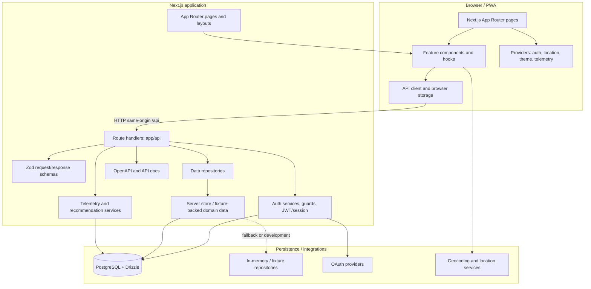

The project has both PostgreSQL/Drizzle schema and fixture/in-memory repository paths. Do not assume every endpoint persists to PostgreSQL: inspect the route's repository/service implementation before changing persistence semantics.

## 2. Site map

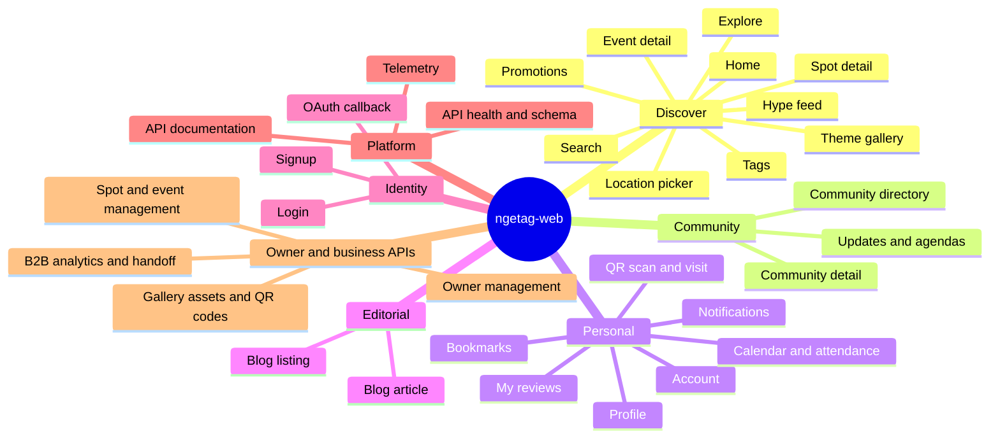

Site map describes user-facing pages plus major platform/API areas. Route files live under `app/`; dynamic pages use `[id]` or `[slug]` segments.

## 3. Database ER diagram

The ERD below captures the primary domain and explicit foreign-key relationships. Some polymorphic references (for example `bookmarks.targetType/targetId`, gallery ownership, QR targets) cannot be expressed as ordinary foreign keys and are labeled accordingly. Auth and telemetry tables are shown as logical supporting groups; consult their schema files for all columns and constraints.

```mermaid
erDiagram
  OWNERS ||--o{ SPOTS : owns
  OWNERS ||--o{ EVENTS : owns
  OWNERS ||--o{ COMMUNITIES : manages
  OWNERS ||--o{ PROMOS : creates
  SPOTS ||--o{ SPOT_OPENING_HOURS : has
  SPOTS ||--o{ SPOT_TAGS : classified_by
  TAGS ||--o{ SPOT_TAGS : labels
  EVENTS ||--o{ EVENT_TAGS : classified_by
  TAGS ||--o{ EVENT_TAGS : labels
  EVENTS ||--o{ EVENT_INTERESTS : matches
  INTERESTS ||--o{ EVENT_INTERESTS : categorizes
  CUSTOMERS ||--o{ CUSTOMER_INTERESTS : selects
  INTERESTS ||--o{ CUSTOMER_INTERESTS : chosen_by
  CUSTOMERS ||--o{ CUSTOMER_FAVORITE_TAGS : selects
  TAGS ||--o{ CUSTOMER_FAVORITE_TAGS : favorited_by
  SPOTS ||--o{ REVIEWS : receives
  SPOTS ||--o{ REVIEW_TAGS : offers
  REVIEWS ||--o{ REVIEW_SELECTED_TAGS : tagged_with
  REVIEW_TAGS ||--o{ REVIEW_SELECTED_TAGS : selected
  SPOTS ||--o{ PROMOS : promotes
  EVENTS ||--o{ PROMOS : promotes
  COMMUNITY_CATEGORIES ||--o{ COMMUNITIES : groups
  COMMUNITIES ||--o{ COMMUNITY_UPDATES : publishes
  COMMUNITIES ||--o{ COMMUNITY_AGENDAS : schedules
  CUSTOMERS ||--o{ BOOKMARKS : saves
  CUSTOMERS ||--o{ EVENT_ATTENDANCES : schedules
  EVENTS ||--o{ EVENT_ATTENDANCES : attended_by
  CUSTOMERS ||--o{ SPOT_VISITS : records
  SPOTS ||--o{ SPOT_VISITS : visited
  CUSTOMERS ||--o{ COMMUNITY_MEMBERSHIPS : joins
  COMMUNITIES ||--o{ COMMUNITY_MEMBERSHIPS : has_members
  OWNERS ||--o{ OWNER_SPOTS : assigned
  SPOTS ||--o{ OWNER_SPOTS : assigned
  OWNERS ||--o{ OWNER_EVENTS : assigned
  EVENTS ||--o{ OWNER_EVENTS : assigned
  OWNERS ||--o{ OWNER_COMMUNITIES : assigned
  COMMUNITIES ||--o{ OWNER_COMMUNITIES : assigned
  OWNERS ||--o{ QR_CODES : administers
  EVENTS ||--o{ HYPE_ITEMS : featured_in

  OWNERS { varchar id PK }
  CUSTOMERS { varchar id PK }
  TAGS { varchar id PK }
  INTERESTS { varchar id PK }
  SPOTS { varchar id PK
    varchar owner_id FK
  }
  SPOT_OPENING_HOURS { varchar spot_id PK,FK
    enum day PK
  }
  EVENTS { varchar id PK
    varchar owner_id FK
  }
  PROMOS { varchar id PK
    varchar owner_id FK
    varchar spot_id FK
    varchar event_id FK
  }
  REVIEWS { varchar id PK
    varchar spot_id FK
  }
  REVIEW_TAGS { varchar id PK
    varchar spot_id FK
  }
  REVIEW_SELECTED_TAGS { varchar review_id PK,FK
    varchar review_tag_id PK,FK
  }
  COMMUNITY_CATEGORIES { varchar id PK }
  COMMUNITIES { varchar id PK
    varchar owner_id FK
    varchar category_id FK
  }
  COMMUNITY_UPDATES { varchar id PK
    varchar community_id FK
  }
  COMMUNITY_AGENDAS { varchar id PK
    varchar community_id FK
  }
  SPOT_TAGS { varchar spot_id PK,FK
    varchar tag_id PK,FK
  }
  EVENT_TAGS { varchar event_id PK,FK
    varchar tag_id PK,FK
  }
  EVENT_INTERESTS { varchar event_id PK,FK
    varchar interest_id PK,FK
  }
  CUSTOMER_INTERESTS { varchar customer_id PK,FK
    varchar interest_id PK,FK
  }
  CUSTOMER_FAVORITE_TAGS { varchar customer_id PK,FK
    varchar tag_id PK,FK
  }
  OWNER_SPOTS { varchar owner_id PK,FK
    varchar spot_id PK,FK
  }
  OWNER_EVENTS { varchar owner_id PK,FK
    varchar event_id PK,FK
  }
  OWNER_COMMUNITIES { varchar owner_id PK,FK
    varchar community_id PK,FK
  }
  BOOKMARKS { varchar id PK
    varchar customer_id FK
    varchar target_id "polymorphic id"
    enum target_type "spot or event"
  }
  EVENT_ATTENDANCES { varchar id PK
    varchar customer_id FK
    varchar event_id FK
  }
  SPOT_VISITS { varchar id PK
    varchar customer_id FK
    varchar spot_id FK
  }
  COMMUNITY_MEMBERSHIPS { varchar id PK
    varchar customer_id FK
    varchar community_id FK
  }
  QR_CODES { varchar id PK
    varchar owner_id FK
    varchar target_id "polymorphic id"
  }
  HYPE_ITEMS { varchar id PK
    varchar event_id FK
  }
  GALLERY_ASSETS { varchar id PK
    varchar owner_id "polymorphic owner"
  }
  BLOGS { varchar id PK }
  NOTIFICATIONS { varchar id PK
    varchar customer_id FK
  }
```

Additional authentication tables (accounts, sessions, credentials/tokens) are defined in `src/db/auth.schema.ts`; event telemetry, taste vectors, and content embeddings are in `src/db/telemetry.schema.ts`. The diagram intentionally focuses on the product domain rather than reproducing every column/index. Verify optional customer foreign keys and polymorphic relations directly in schema before writing migrations.

## 4. Use-case sequence diagrams

These diagrams cover the primary user journeys exposed by the UI and API. Request validation, auth checks, and persistence vary per endpoint; branches are illustrative and should be checked against current handlers before implementation.
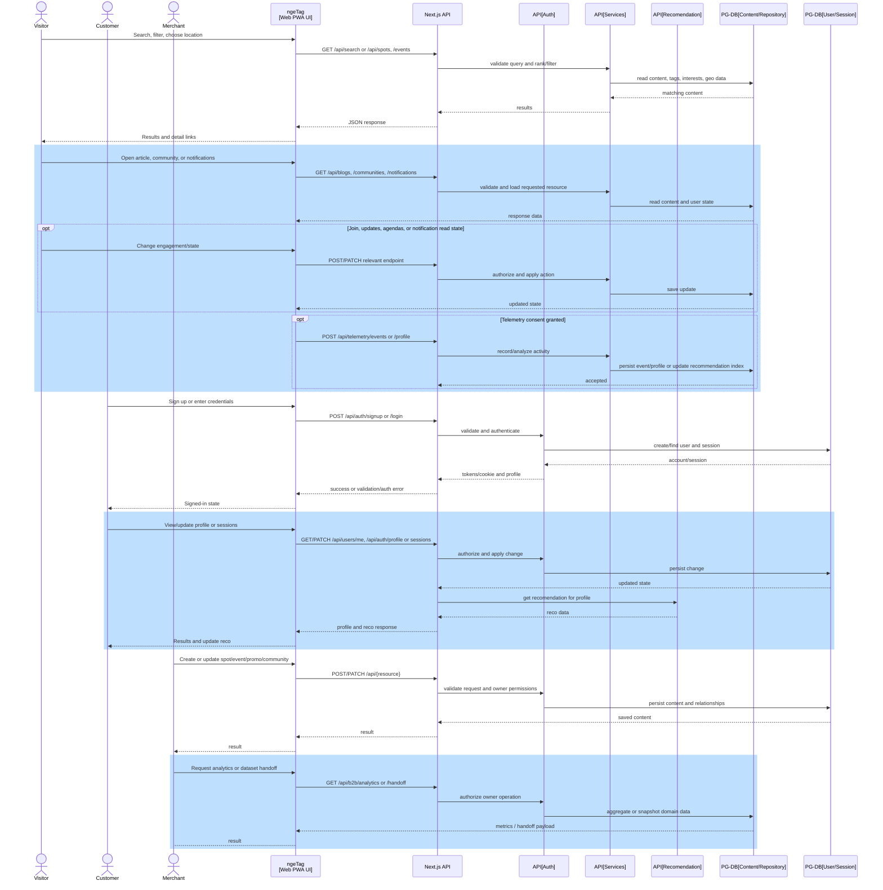

### Discover, search, and recommendations
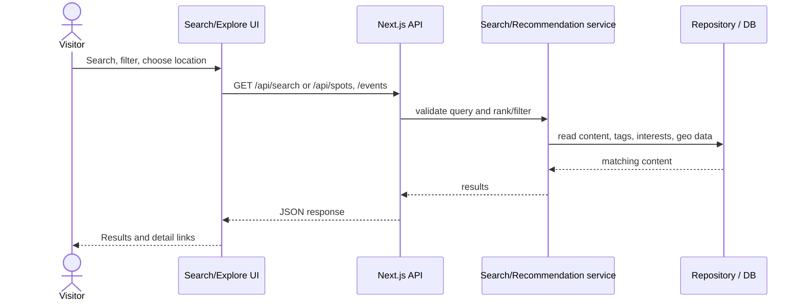

### Account creation, login, session and profile
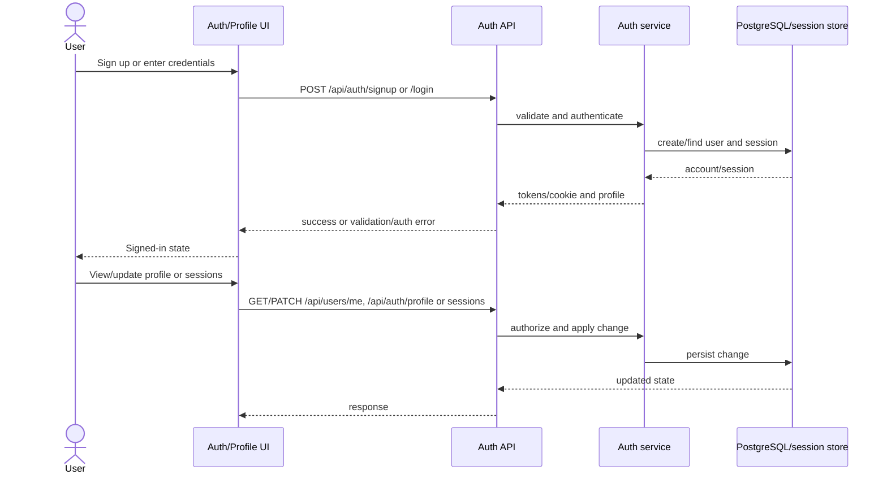

### OAuth sign-in
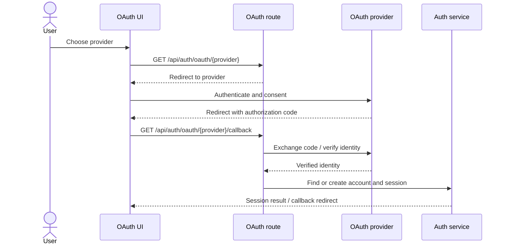

### Spot review, QR visit, and helpful vote
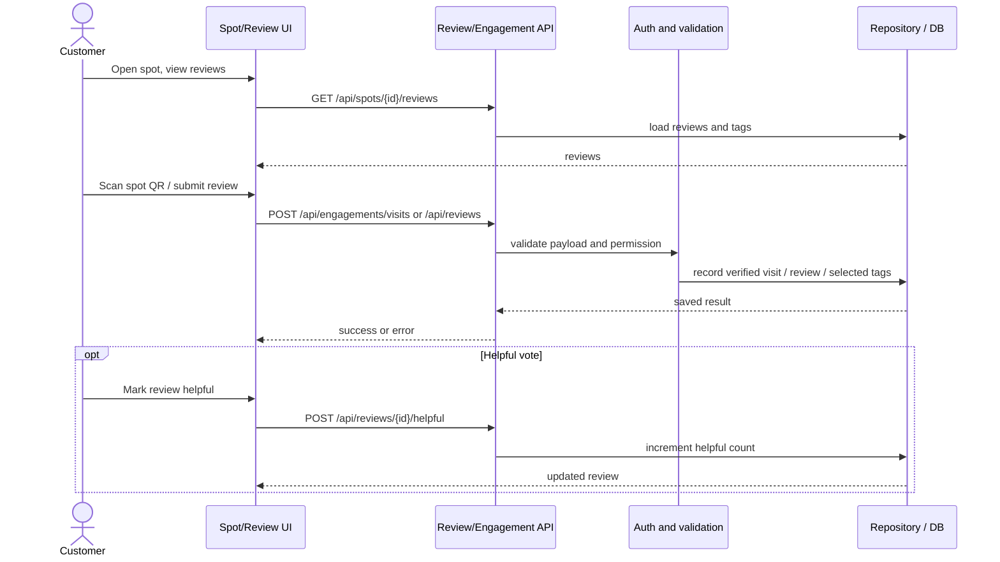

### Bookmark, event attendance, community membership
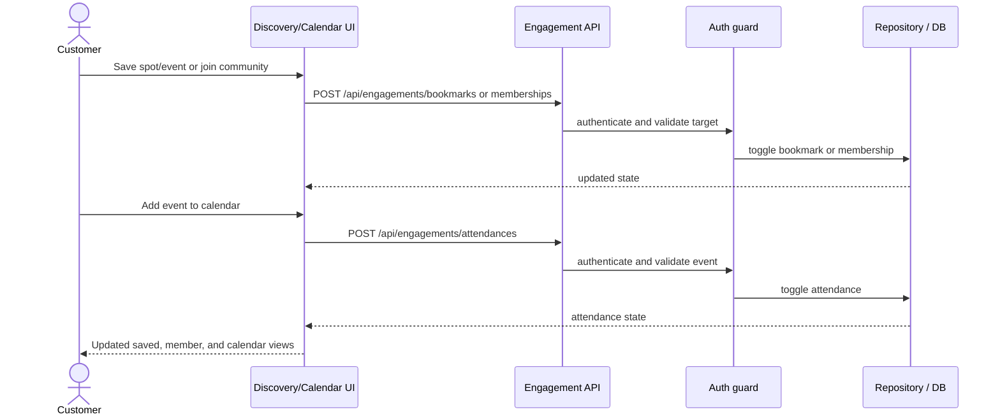

### Owner content management and business analytics
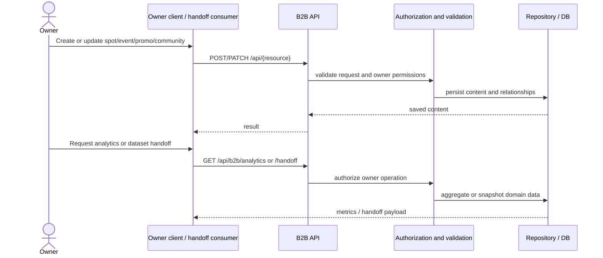

### Editorial, communities, notifications, and telemetry
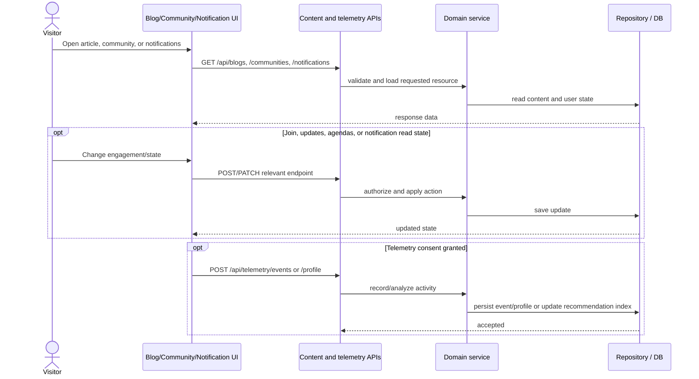

## 5. Maintaining existing features

- **Establish behavior first:** identify the route/page, feature component, API handler, repository/service, schema, and tests/docs involved. Read related contracts and current user-facing behavior before editing.
- **Preserve contracts:** keep existing URLs, HTTP methods, payload shapes, response envelopes, query semantics, auth requirements, and error behavior backward-compatible unless the Product Owner explicitly approves a breaking change. Update OpenAPI/docs when a contract changes.
- **Keep boundaries:** pages compose `src/features/*`; shared UI belongs in `src/components/*`; API handlers validate with `src/schemas/*` and delegate domain work rather than embedding business logic. Reuse the API client, auth guards, and repository patterns.
- **Protect data:** schema changes require deliberate Drizzle updates and migration/deployment consideration. Check `src/db/relations.ts`, seed data, fixtures, and both PostgreSQL and fallback repository paths. Avoid destructive or implicit data transformations.
- **Test regression paths:** cover success, empty state, invalid input, unauthenticated/unauthorized access, and relevant failure states. Run `npm run lint`, `npx tsc --noEmit`, and targeted tests (where present); run build for broad or routing changes. Check mobile/PWA behavior and accessibility for UI changes.
- **Keep documentation aligned:** update this file, API/schema docs, and route/feature documentation as needed. Note intentional deviations or known limitations.

## 6. Adding a feature from a Product Owner change request

1. **Capture the request:** record problem statement, target users, business outcome, scope and non-goals, acceptance criteria, priority, analytics needs, and release constraints. Resolve ambiguity with the PO before implementation.
2. **Assess impact:** map the request to existing pages/use cases, API contracts, auth/roles, data model, integrations, privacy/security, accessibility, and operational/deployment impacts. Identify compatibility risks and migration/backfill/rollback needs.
3. **Propose design:** describe UI states, endpoint/payload changes, schema/relationship changes, failure handling, telemetry, and test plan. For behavior or contract changes, obtain PO approval of acceptance criteria and API/data approach before coding.
4. **Implement in the established layers:** add or update route and feature modules, schemas/contracts, domain service/repository, persistence and UI. Prefer small additive changes; use a feature flag where rollout risk warrants it. Never bypass authorization or validation to meet a UI-only requirement.
5. **Verify:** add automated tests for acceptance criteria and regression cases; run lint, typecheck, and relevant build/checks. Validate migrations against representative existing data and verify rollback strategy for production data changes.
6. **Review and release:** provide a concise change summary, test evidence, migration/deployment steps, risks, and rollback plan for review. Obtain required code and PO acceptance, deploy through the normal release process, monitor errors/usage, and close the request only after acceptance criteria are met.
7. **Maintain the record:** update diagrams, API/schema docs, release notes, and operational guidance. Record follow-up work rather than silently expanding scope.
